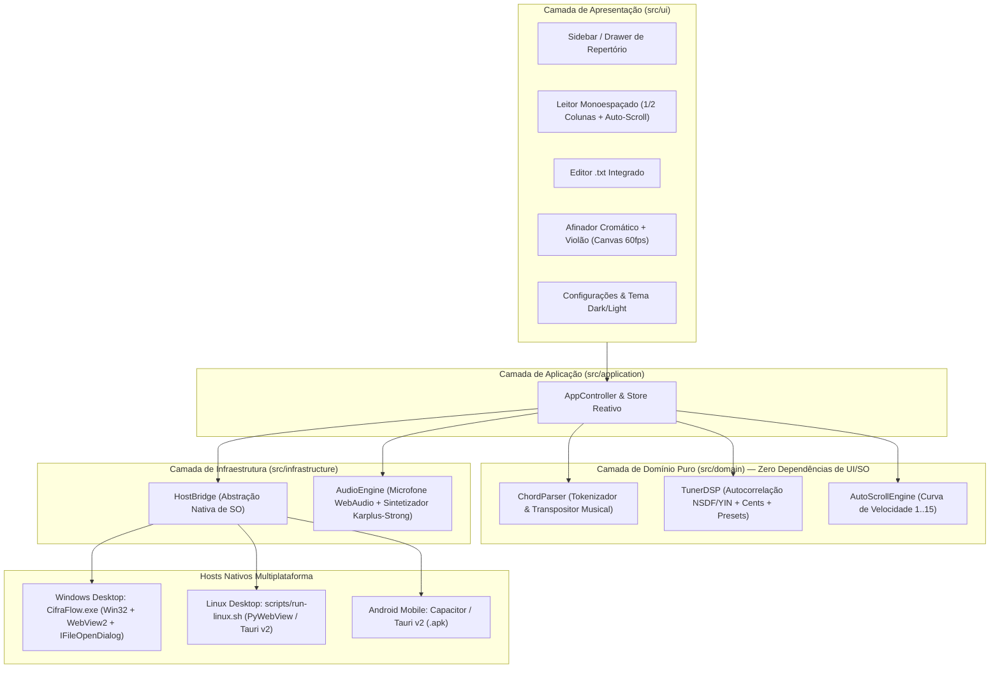

# SDD Fase 2: Plano Arquitetural (Plan) — CifraFlow

## 1. Arquitetura Escolhida: Monolito Modular + Host Nativo Multiplataforma

Para atender simultaneamente à execução **100% nativa no Desktop** (Windows e Linux, sem abrir navegador) e à geração de **`.apk` para Android** a partir da mesma base de código, adotamos a arquitetura de **Monolito Modular em Camadas (Clean Architecture)** acoplada a um **Host Nativo WebView2 (`CifraFlow.exe` em C#/Win32 no Windows)** e configurada para **Tauri v2 / Capacitor Android (`.apk`)**:

## 2. Design dos Módulos e Contratos
1. **`src/domain/chord-parser.js`:**
   - `isChordToken(token)`: Valida se um token isolado obedece à gramática musical (`^[A-G][#b♯♭]?(?:m|maj|min|dim|aug|sus|add)?(?:[0-9]{1,2})?(?:(?:7M|7m|9|11|13|4|5|6|7|dim|aug|sus[24]?|\([#b+-]?[0-9]{1,2}(?:[/,][#b+-]?[0-9]{1,2})*\)))*(?:\/[A-G][#b♯♭]?)?$`).
   - `classifyLine(line)`: Distingue linhas de acordes, linhas mistas com marcadores (`[Intro] Am Dm G`, `Introdução: G (2X)`, `Tom: Sol (G)`), cabeçalhos de seção (`[Refrão]`, `[Solo]`) e linhas de letra.
   - `parseChordLineTokens(line)`: Retorna lista de segmentos `{ text, isChord, isSection }` preservando 100% dos espaços originais.
   - `transposeText(text, semitones)`: Transpõe todos os acordes da cifra em $N$ semitons mantendo o alinhamento espacial.
2. **`src/domain/tuner-dsp.js`:**
   - `detectPitch(float32Buffer, sampleRate)`: Calcula a frequência fundamental via função de diferença quadrática normalizada (NSDF/YIN) com threshold de clareza e interpolação parabólica.
   - `analyzeFrequency(freqHz, tuningPreset, lockedStringIndex)`: Converte `freqHz` em nota cromática (`C` a `B`), oitava, corda mais próxima do violão (`E2`, `A2`, `D3`, `G3`, `B3`, `E4`), frequência alvo e desvio exato em `cents`.
3. **`src/domain/autoscroll-engine.js`:**
   - Gerencia estado `{ active, speed }` (velocidade `1` a `15`, padrão `1`), incremento (`+`), decremento (`-`) e cálculo de deslocamento vertical ($\Delta y$) por frame.
4. **`native-host/CifraFlowHost.cs` -> `CifraFlow.exe`:**
   - Aplicativo nativo Windows compilado com `csc.exe` e `Microsoft.Web.WebView2`, janela desktop dedicada com barra de título escura DWM, diálogo nativo `IFileOpenDialog` (`FOS_PICKFOLDERS`, idêntico ao Print 3), leitura de `.txt` com detecção automática de encoding UTF-8 / Windows-1252, escrita direta em disco e permissão automática de microfone.
